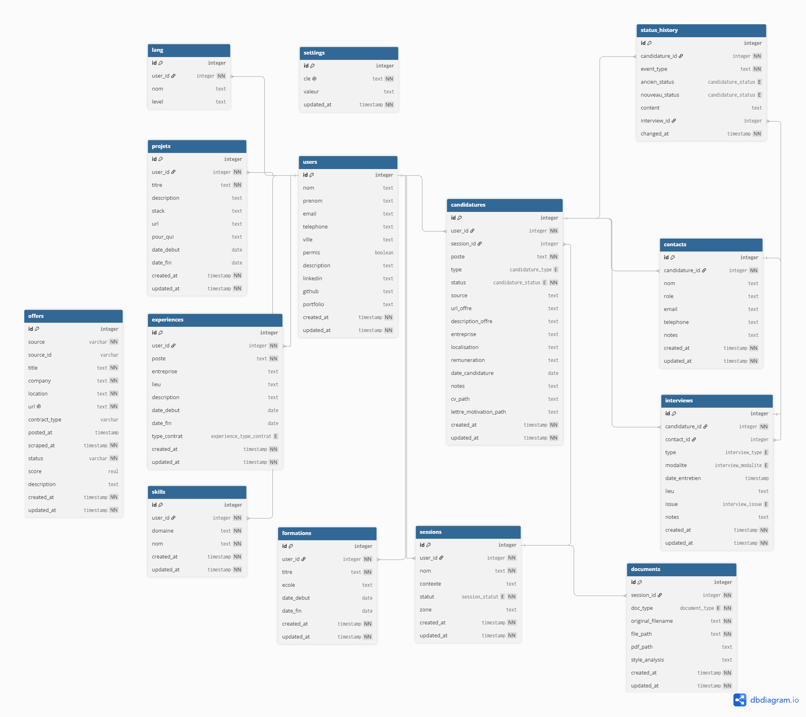

# FindMyJob

Logiciel open source pour suivre ses candidatures.

FindMyJob aide les étudiants à organiser leur recherche de stage, d'alternance ou de CDI, de la première offre repérée jusqu'à la réponse finale. Au-delà du simple suivi, l'app intègre de l'IA pour supprimer les tâches pénibles : remplir une fiche d'offre, écrire une relance, adapter sa candidature.

Les données restent locales sur ta machine (SQLite). Seule l'inférence IA passe par le cloud.

## Stack utilisé

| Couche | Technologie |
|--------|-------------|
| Application desktop | Tauri 2 (Windows / macOS / Linux) |
| Frontend | Vue 3 + TypeScript + Tailwind CSS |
| Backend | Rust |
| Base de données | SQLite (locale, mono-utilisateur) |
| IA | Couche compatible OpenAI → Ollama Cloud (free tier), modèle configurable dans les paramètres |

La couche IA est construite sur une base URL configurable : aujourd'hui Ollama Cloud, demain un runtime local sans réécriture.

## Les features

### Suivi des candidatures

- Gestion des candidatures : entreprise, poste, type (stage / alternance / CDI), contact, notes, version du CV associée
- Pipeline de statut : à postuler → postulé → relancé → entretien → offre / refus
- Vues kanban et liste
- Rappels de relance automatiques

### Assistance IA

- **Extraction d'offre** : colle le texte d'une annonce, l'IA remplit la fiche (entreprise, intitulé, type, lieu, stack, date limite, rémunération)
- **Relances intelligentes** : détection des candidatures en attente et génération du mail de relance adapté au statut
- **Tailoring CV / lettre de motivation** : à partir de ton profil et de l'offre, ce qu'il faut mettre en avant
- **Matching profil ↔ offre** : pour une offre donnée, classement de tes projets par pertinence *(en cours de développement)*

### À venir

Recherche d'offres en ligne · mode IA local · synchronisation multi-appareils.

## Base de données

Les données sont stockées localement dans un fichier SQLite. Le schéma est versionné dans `db/migrations/`.

| Table | Rôle |
|---|---|
| `users` | Profil de l'utilisateur (nom, contact, permis, liens LinkedIn/GitHub) |
| `lang` | Langues parlées par l'utilisateur et niveau associé |
| `projets` | Projets personnels associés au profil |
| `experiences` | Expériences professionnelles du profil |
| `skills` | Compétences classées par domaine |
| `candidatures` | Cœur de l'app — une ligne par candidature (entreprise, statut et métadonnées) |
| `status_history` | Historique des changements de statut d'une candidature |
| `contacts` | Interlocuteurs associés à une candidature (RH, manager…) |
| `interviews` | Entretiens planifiés ou passés pour une candidature |
| `documents` | CV et lettres de motivation (références et versions adaptées par candidature) |
| `emails` | Emails envoyés depuis l'app (candidature, relance, remerciement…) |
| `email_attachments` | Documents joints à un email |
| `embeddings` | Vecteurs sémantiques pour le matching profil ↔ offre (table polymorphe) |
| `settings` | Paramètres de l'app en clé-valeur (modèle IA, thème…) |



## Installation

### Prérequis

- [Node.js](https://nodejs.org/) 18+
- [Rust](https://rustup.rs/) (stable)
- Dépendances système Tauri : [guide officiel](https://tauri.app/start/prerequisites/)

### Développement

```bash
git clone https://github.com/KanASon/FindMyJob.git
cd FindMyJob
npm install
npm run tauri dev
```

### Build de production

```bash
npm run tauri build
```

L'installeur est généré dans `src-tauri/target/release/bundle/`.

## Convention de commits

Le projet utilise les **Conventional Commits** pour automatiser le versioning.

Format : `<type>(<scope optionnel>): <description>`

**Types principaux :**
- `feat:` — nouvelle fonctionnalité → incrémente la version **mineure** (0.1.0 → 0.2.0)
- `fix:` — correction de bug → incrémente le **patch** (0.1.0 → 0.1.1)
- `feat!:` ou `fix!:` ou `BREAKING CHANGE` dans le body → incrémente la version **majeure** (0.1.0 → 1.0.0)

**Autres types** (ne déclenchent PAS de release) :
- `docs:` — documentation uniquement
- `style:` — formatage, pas de changement de logique
- `refactor:` — refactoring sans ajout ni correction
- `test:` — ajout ou modification de tests
- `chore:` — maintenance (CI, dépendances, config)

**Exemples concrets :**
```
feat: ajout du drag & drop sur le kanban
fix: correction du crash au redimensionnement de la sidebar
feat(profile): ajout de l'upload de lettre de motivation
refactor: découpage de ProfileView en sous-composants
docs: mise à jour du README avec la convention de commits
chore: mise à jour des dépendances npm
feat!: refonte complète de l'API backend
```

## Flux de branches

- `feature/*` → PR vers `dev` (CI : lint + clippy + tests)
- `dev` → PR vers `staging` (pré-production, tests manuels)
- `staging` → PR vers `main` (déclenche la release automatique)

## À propos

Je suis étudiant en ingénierie informatique et, comme beaucoup, je galére à trouver un stage. Entre les dizaines de candidatures à suivre, les relances à ne pas oublier et les fiches à remplir à la main, j'ai fini par construire mon propre outil pour m'y retrouver. J'ai décidé de le rendre open source pour aider les gens qui sont dans la même situation.