# FindMyJob

**[English](#english) · [Français](#francais)**

<a id="english"></a>

Open-source desktop app to track your job applications.

FindMyJob helps students organize their search for an internship, apprenticeship, or full-time job, from the first offer they spot to the final answer. Beyond plain tracking, it uses AI to remove the tedious parts: filling in an offer's details, drafting a follow-up, tailoring a CV and cover letter to the job.

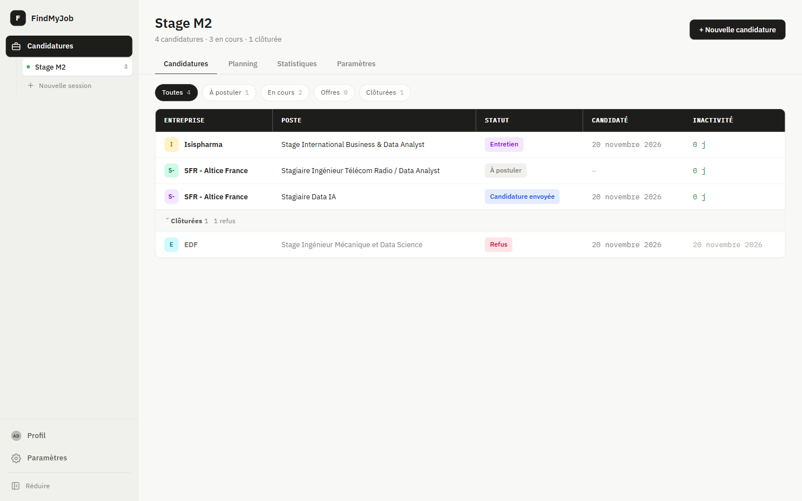

## Features

- **Application tracking** — company, position, contract type (internship / apprenticeship / temp / fixed-term / permanent), offer platform, recruiter contacts, notes, and a full timeline (applied, follow-ups, messages, calls, interviews, offer, outcome). A progress bar shows where each application stands (to apply → sent → interviews → offer → accepted), and where a closed one stopped.
- **Filters and closed applications** — quick filters (all, to apply, in progress, offers, closed) on each session's table. Rejected, withdrawn, ghosted and declined-offer applications are gathered in a collapsible « Closed » group, with a count per outcome.
- **Sessions** — each search (for example "Internship 2027") has its own applications, reference documents, sender city and status: active, paused or finished. A paused or finished session stays readable but is read-only (only its status can still change); accepting an offer sets the session to finished automatically.
- **AI-tailored CV and cover letter** — generated from your profile and the offer's text, in your own document's style, entirely in the offer's language (French or English). Writing instructions are comments in your reference document, in a documented format ([`docs/reference-markup.md`](docs/reference-markup.md)). The list symbol of the generated CV (bullet « • » or dash « - ») is a setting of the session.
- **AI-drafted application message** — a short email or platform message adapted to the offer when you apply, addressed to the recruiter contact when there is one. The CV, cover letter and message are exported to your downloads folder.
- **Offer import** — paste a job listing's URL and the form is prefilled automatically (title, company, location, contract type, pay, full description, contact) for you to review. The page's structured data (JSON-LD) is used when available, otherwise its text is analyzed by the AI. If a site refuses automatic reading, you can open the page inside FindMyJob (accept cookies, log in), capture it, paste its text, or fill the form by hand. An existing application for the same offer is flagged.
- **Session statistics** — key figures (applications sent, response rate, interview rate, delay to the first response), funnel (sent → response → interview → offer), outcomes, activity per week over the last 9 weeks, interviews, durations and follow-ups, and a « What works » comparison by CV template, cover-letter template, offer platform and recruiter contact (with / without). Rows with too few applications are greyed out.
- **Interview planning** — week and month views of the session's interviews.
- **Interface** — collapsible sidebar (remembered, folded automatically when the window is narrower than 1100 px), layouts that adapt to the window's width, light / dark / system theme, French or English interface (independent of the documents' language).

Every offer enters the app through its link (or its pasted text): FindMyJob never collects offers on its own.

## Usage

The typical path, from first launch to your first tailored application.

### 1. Fill in your basic information

On first launch, a six-step wizard asks for the interface language (English or French, changeable later in **Settings**), then your identity, contact details, driving licence, a short description and your links (LinkedIn, GitHub, portfolio). Only your first name, last name and email are required; everything can be edited later.

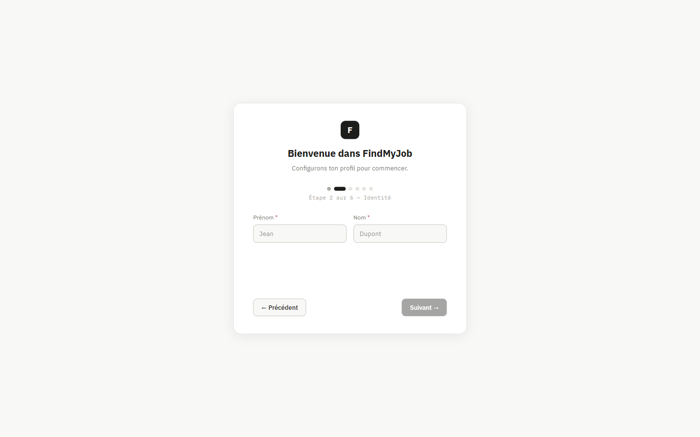

### 2. Add your Anthropic API key

The AI features (offer import, CV and cover letter tailoring, application messages) need an [Anthropic API key](https://console.anthropic.com/). Open **Settings → Artificial intelligence** and choose the model (Claude Sonnet 4.6, recommended, or Claude Haiku 4.5, faster and cheaper). Then click **Replace**, paste your key and save it: the connection test runs right after, and **Test** runs it again (see [Anthropic API key](#anthropic-api-key)). Only the key's last 4 characters are shown.

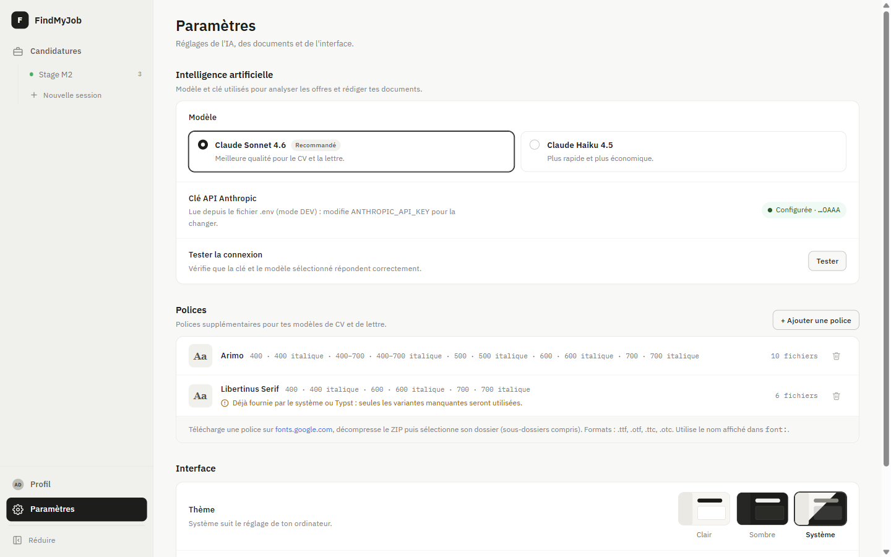

### 3. Complete your profile in detail

Open your profile with **Profile** at the bottom of the sidebar. Your identity, contact details, skills and languages are on the left; the description, experiences, education and projects on the right. Each section is edited on its own, with its pencil icon. Also set the language your profile is written in.

- **Descriptions** (experiences, projects, education): a line that starts with `-` becomes a list item; text without a dash stays a block (an introduction before the items, or the continuation of the previous item).
- **Detailed context** (experiences and projects, up to 2,000 characters): background the AI reads to write the cover letter and choose the projects. It is never shown on the CV.

The more detail you give, the better the generated documents: the AI only uses what your profile says and never invents facts.

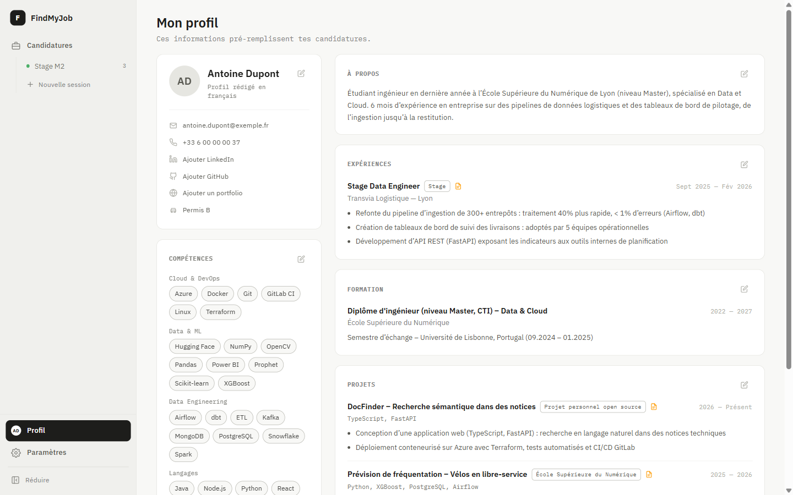

### 4. Write your CV and cover letter in Typst with Claude

FindMyJob tailors *your own* documents, so it needs a reference CV and cover letter written in [Typst](https://typst.app/) (`.typ` files). If you don't have them yet, ask [Claude](https://claude.ai/) to convert your current CV and cover letter (PDF or Word) to Typst, then check the result compiles and looks right.

You can add writing instructions as `//` comments in the file (`[CONSIGNES]`, `[FIXE]`, `[VARIABLE]`, `[ADAPTABLE]`) to say which parts stay word for word and which are rewritten for each offer. See [`docs/reference-markup.md`](docs/reference-markup.md).

Two complete examples for a fictional student are in the repository: [`docs/cv_exemple.typ`](docs/cv_exemple.typ) and [`docs/lm_exemple.typ`](docs/lm_exemple.typ) (in French, using the Arimo font). You can import them as they are to try the app, or use them as a model for your own documents.

### 5. Import the fonts used by your documents

If your CV or cover letter uses fonts that are not built in, import them before importing the documents, so the generated PDFs match your originals: download the font (for example from [Google Fonts](https://fonts.google.com/)), unzip it, then select its folder in **Settings → Fonts** (**+ Add a font**). Write in `font:` the exact family name shown there. A document that uses a missing font is refused at import instead of silently falling back to another font.

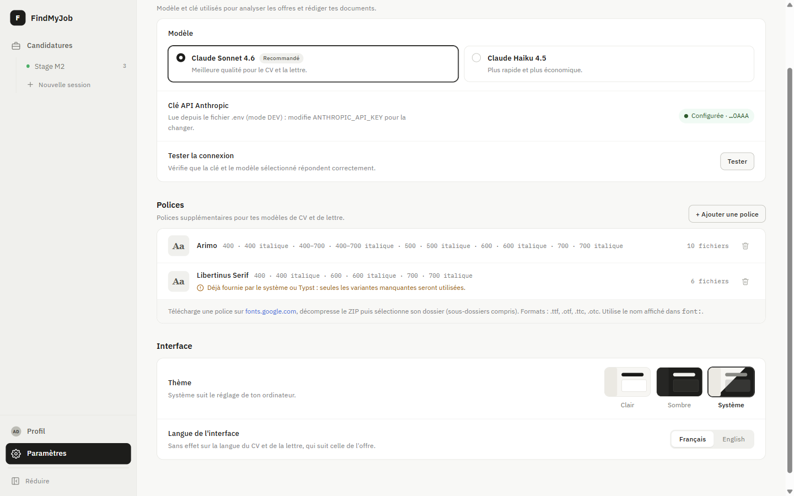

### 6. Create a session and import your documents

A session groups the applications of one search (for example "Internship 2027"). Click **New session** in the sidebar and name it (you can also enter your city and postal code now). Then open the session's **Settings** tab:

- **Session** — name, city and postal code, status and CV list symbol. The city is the sender's location on your CV and cover letters: it belongs to the session and is required to create an application; the postal code is optional. The status is **Active**, **Paused** or **Finished**: a paused or finished session is read-only until you set it back to active. **CV lists** chooses the symbol in front of each list item of the generated CVs (**• Bullet** or **- Dash**); the app itself always shows bullets.
- **Document templates** — one card for the CV, one for the cover letter: import your `.typ` file, preview it, replace it, or restore an earlier version from its history. Each session has its own reference documents, analyzed once at import.

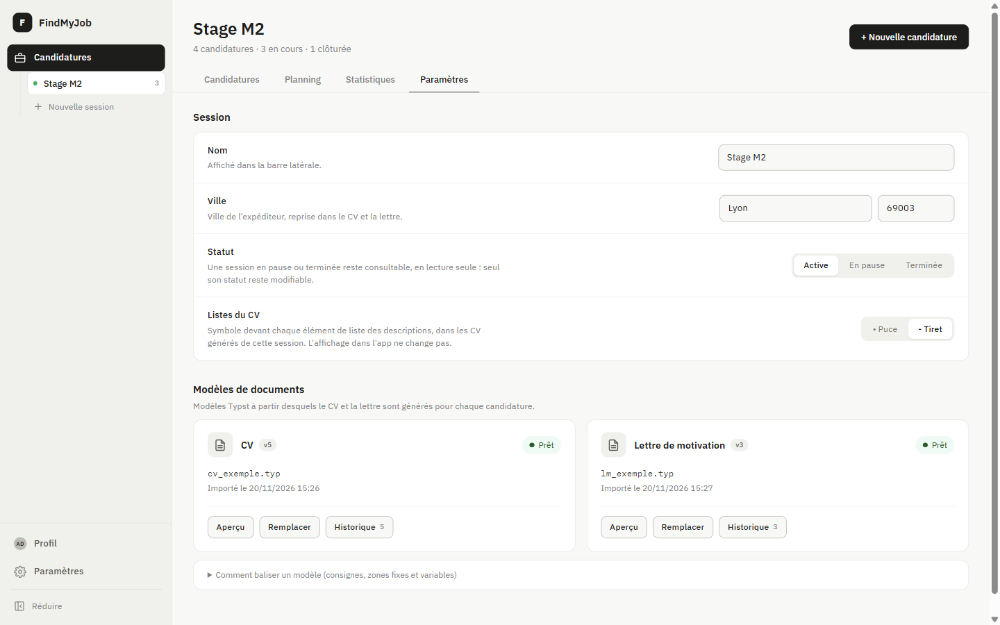

### 7. Add offers and apply

In your session, click **+ New application**. Creation has three steps:

1. **Offer** — paste the offer's link and click **Analyse**: the form is filled in automatically. If the site can't be read, open the page inside FindMyJob, paste its text, or fill the form by hand.
2. **Details** — review the position, the offer's content, the recruiter contacts and your notes. The **Ready to generate?** card checks that the required fields are filled in, that the CV and cover-letter templates are imported, that the session has a city and that it is active.
3. **Generation** — **Create and generate the documents** writes a CV and a cover letter tailored to the offer, in the offer's language.

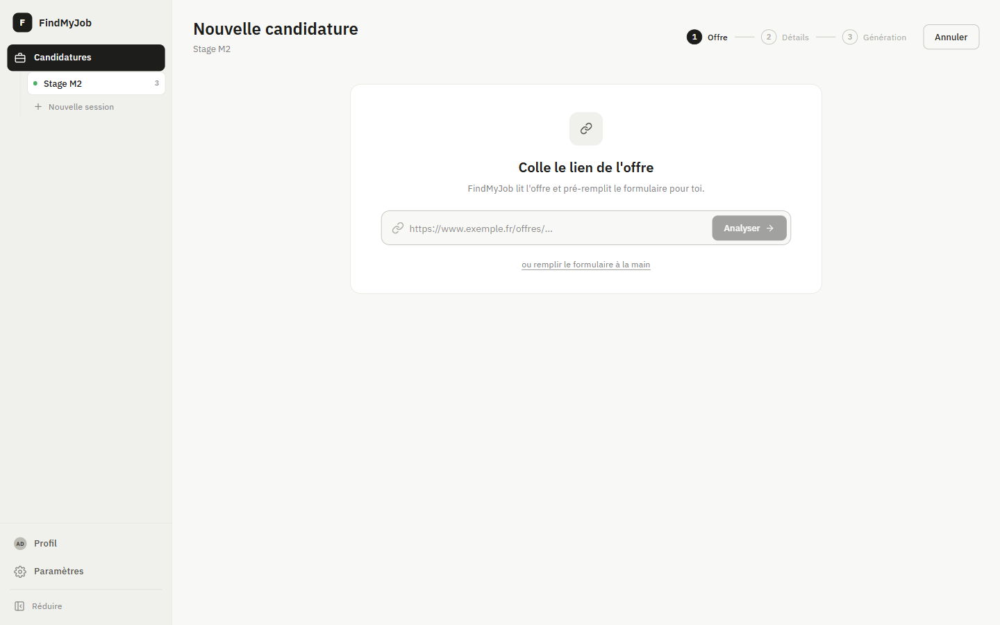
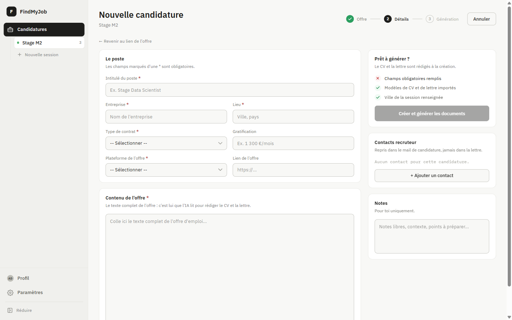

From the application's page, you then:

- **Apply** — by email or by a message on the offer's platform (drafted by the AI), or **Already applied, no message**. The application moves to « Application sent », its information is frozen, and the CV, cover letter and message are saved in `Downloads/FindMyJob/`.
- **Add an event** — messages, calls, interviews (with their interviewers), follow-ups, notes, offer, rejection, ghosting, withdrawal. Only the events allowed in the current status are offered.
- Follow its progress, view or download the generated documents, and manage its recruiter contacts.

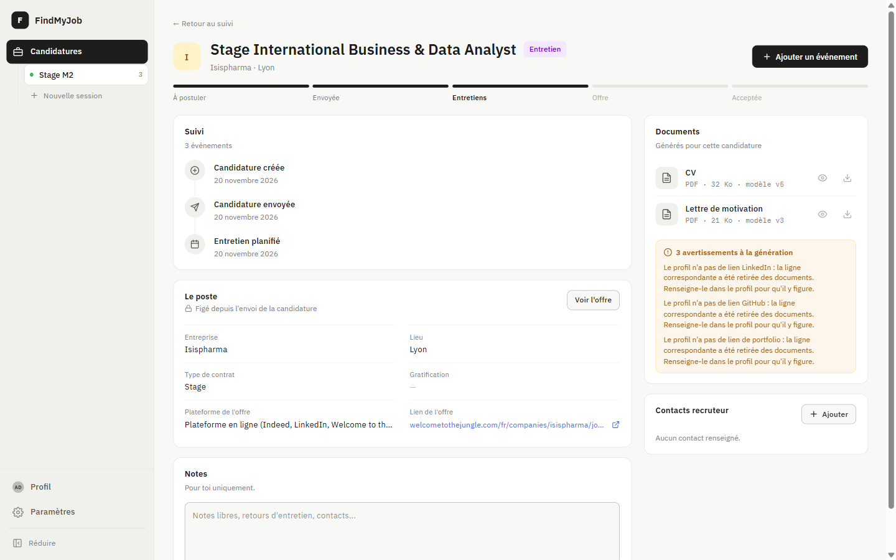

The session's **Planning** tab shows its interviews by week or by month, and the **Statistics** tab its figures once at least 3 applications have been sent.

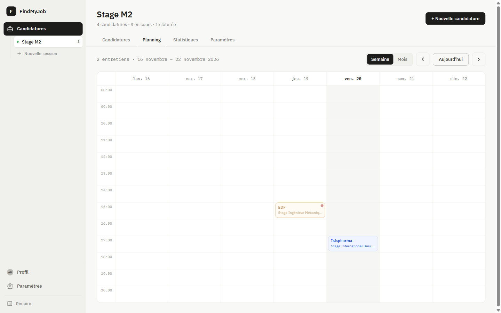
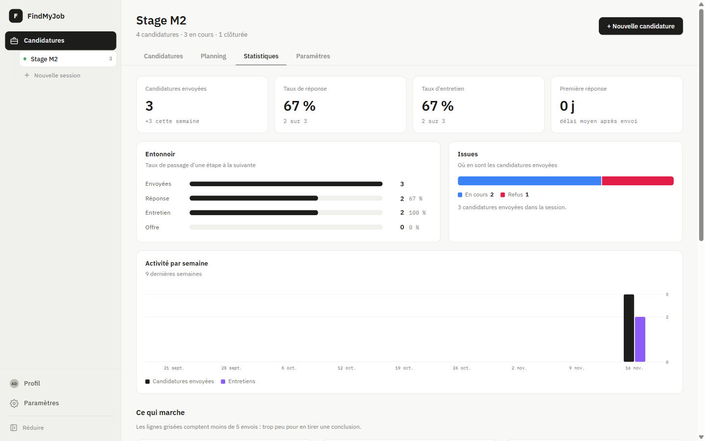

## Architecture

FindMyJob is a standalone desktop app: one process, no server, no Docker. It follows the standard Tauri layout:

```
src/        Vue 3 frontend
src-tauri/  Tauri 2 Rust backend — owns the SQLite database, the LLM calls, the offer import, the documents pipeline and the business rules
```

The Vue frontend calls Tauri commands, which call the business logic directly. See [`docs/project.md`](docs/project.md) for the full technical reference (data model, pipelines, commands, conventions).

## Data

Everything is stored locally, in the data folder: a SQLite database (`findmyjob.db`), your reference documents and generated PDFs (`documents/`) and imported fonts (`polices/`). The schema is created and migrated automatically at startup; see [`db/schema.dbml`](db/schema.dbml) for the column-level reference.

The data folder depends on the run mode, set by `MODE` in `.env`:

| Mode | Data folder | Logs and WebView profiles |
|---|---|---|
| PROD (default) | app data folder (on Windows `%APPDATA%\com.findmyjob.app\`) | app local folder (on Windows `%LOCALAPPDATA%\com.findmyjob.app\`, logs in `logs\findmyjob.log`) |
| DEV | `dev-data/` next to the `.env` that declared `MODE=DEV` (in development, the repository root) | same `dev-data/` folder (`logs/`, `webview/`, `capture_webview/`) |

`MODE` is read from the `.env` that was loaded: no `.env`, `MODE` absent or `MODE=PROD` → PROD; `MODE=DEV` → DEV; any other value is a startup error (case is ignored). In DEV mode nothing is written to the system app folders. `dev-data/` is gitignored and created when missing.

## Prerequisites

- [Node.js](https://nodejs.org/) 18+
- [Rust](https://rustup.rs/) (stable)
- Tauri system dependencies: [official guide](https://tauri.app/start/prerequisites/)
- An [Anthropic API key](https://console.anthropic.com/) for the AI features
- On Linux, a running Secret Service (GNOME Keyring, KWallet) to store the key in PROD mode

## Getting started

```bash
git clone https://github.com/LeMages/FindMyJob.git
cd FindMyJob
cp .env.example .env   # set MODE=DEV for an isolated dev-data/ folder, and fill in ANTHROPIC_API_KEY
npm install
npm run tauri dev
```

In development, the `.env` at the repository root is found automatically. An installed app reads it from its config folder (on Windows `%APPDATA%\com.findmyjob.app\.env`). Logs are written to `findmyjob.log` in the log folder of the run mode (see [Data](#data)); the first startup line gives the mode and the folders in use.

### Anthropic API key

Where the key is read depends on the run mode:

- **DEV**: from `ANTHROPIC_API_KEY` in the `.env`. The system keyring is never used; the **Settings** page shows the key's state read-only.
- **PROD**: from the system keyring (Windows Credential Manager, macOS Keychain, Linux Secret Service; entry `com.findmyjob.app` / `anthropic_api_key`). A key in a `.env` is ignored. Open **Settings → Artificial intelligence**, paste the key and click **Save**: the connection test runs right after. The key can be replaced or deleted from the same block.

The full key never reaches the interface (only its last 4 characters) and never appears in logs or error messages. If the keyring is unavailable (for example Linux without Secret Service), the app reports it explicitly; there is no fallback to a file.

### Production build

```bash
npm run tauri build
```

The installer is generated under `target/release/bundle/` at the repo root.

### Tests

```bash
cargo test --workspace   # Rust: business rules, database, offer import, documents pipeline
npm test                 # frontend (Vitest): display logic of the views
```

Run from the repository root.

## Tech stack

| Layer | Technology |
|---|---|
| Desktop shell | Tauri 2 (Windows / macOS / Linux) |
| Frontend | Vue 3 + TypeScript + Vite + Tailwind CSS |
| Backend | Rust, inside the Tauri app |
| Database | SQLite, via sqlx |
| Document generation | Typst (`typst-as-lib`) |
| AI | Anthropic Claude Messages API |

## License

[MIT](LICENSE)

## Project status

Active early-stage development. Application tracking (with a recruiter-contact book shared across applications, progress, closed-application grouping and session statuses), AI document tailoring, application messages, offer import by link, interview planning and session statistics are implemented end to end, in French and English — see [`docs/project.md`](docs/project.md#11-features--implemented-partial-and-planned) for the full picture.

## History

An early version collected offers automatically (Welcome to the Jungle, filtering, LLM scoring). I removed it after realizing this approach went against the terms of use of several job platforms. The app now relies on adding offers by their link. The original pipeline is still available at the `archive/collecte-automatique` tag.

Until October 2026, the app ran in server mode: a local Axum agent with PostgreSQL in Docker, the desktop being a thin HTTP client. It is now a standalone desktop application with an embedded SQLite database; the server-mode version is kept at the `archive/agent-postgres` tag.

## About

I'm a computer engineering student and, like many, struggling to find an internship. Between dozens of applications to track, follow-ups to remember, and forms to fill by hand, I ended up building my own tool to stay on top of it. I decided to open-source it to help people in the same situation.

---

<a id="francais"></a>

# FindMyJob (français)

**[English](#english) · [Français](#francais)**

Application de bureau open source pour suivre vos candidatures.

FindMyJob aide les étudiants à organiser leur recherche de stage, d'alternance ou d'emploi, de la première offre repérée jusqu'à la réponse finale. Au-delà du simple suivi, elle utilise l'IA pour supprimer les tâches fastidieuses : remplir les détails d'une offre, rédiger une relance, adapter un CV et une lettre de motivation au poste.


## Fonctionnalités

- **Suivi des candidatures** — entreprise, poste, type de contrat (stage / alternance / intérim / CDD / CDI), plateforme de l'offre, contacts recruteur, notes et historique complet (envoi, relances, messages, appels, entretiens, offre, issue). Une barre de progression montre où en est chaque candidature (à postuler → envoyée → entretiens → offre → acceptée), et où une candidature clôturée s'est arrêtée.
- **Filtres et candidatures clôturées** — filtres rapides (toutes, à postuler, en cours, offres, clôturées) sur le tableau de chaque session. Les candidatures refusées, abandonnées, ghostées ou dont l'offre a été déclinée sont regroupées dans un bloc « Clôturées » repliable, avec le nombre par issue.
- **Sessions** — chaque recherche (par exemple « Stage 2027 ») a ses propres candidatures, documents de référence, ville d'expédition et statut : active, en pause ou terminée. Une session en pause ou terminée reste consultable mais en lecture seule (seul son statut reste modifiable) ; accepter une offre passe automatiquement la session en « terminée ».
- **CV et lettre de motivation adaptés par l'IA** — générés à partir de votre profil et du texte de l'offre, dans le style de votre propre document, entièrement dans la langue de l'offre (français ou anglais). Les consignes de rédaction sont des commentaires dans votre document de référence, selon un format documenté ([`docs/reference-markup.md`](docs/reference-markup.md)). Le symbole des listes du CV généré (puce « • » ou tiret « - ») est un réglage de la session.
- **Message de candidature rédigé par l'IA** — un court email ou message sur la plateforme, adapté à l'offre au moment de postuler, adressé au contact recruteur s'il y en a un. Le CV, la lettre et le message sont exportés dans votre dossier de téléchargements.
- **Import d'offre** — collez le lien d'une offre et le formulaire est prérempli automatiquement (intitulé, entreprise, lieu, type de contrat, rémunération, description complète, contact) pour que vous le vérifiiez. Les données structurées de la page (JSON-LD) sont utilisées quand elles existent, sinon son texte est analysé par l'IA. Si un site refuse la lecture automatique, vous pouvez ouvrir la page dans FindMyJob (accepter les cookies, vous connecter) et la capturer, coller son texte, ou remplir le formulaire à la main. Une candidature existante pour la même offre est signalée.
- **Statistiques par session** — chiffres clés (candidatures envoyées, taux de réponse, taux d'entretien, délai avant la première réponse), entonnoir (envoyées → réponse → entretien → offre), issues, activité par semaine sur les 9 dernières semaines, entretiens, durées et relances, et une comparaison « Ce qui marche » par template de CV, template de lettre, plateforme d'origine et contact recruteur (avec / sans). Les lignes qui comptent trop peu de candidatures sont grisées.
- **Planning des entretiens** — vues semaine et mois des entretiens de la session.
- **Interface** — barre latérale repliable (état mémorisé, repliée automatiquement quand la fenêtre fait moins de 1100 px de large), mise en page qui s'adapte à la largeur de la fenêtre, thème clair / sombre / système, interface en français ou en anglais (indépendante de la langue des documents).

Chaque offre entre dans l'application par son lien (ou son texte collé) : FindMyJob ne collecte jamais d'offres de lui-même.

## Utilisation

Le parcours type, du premier lancement à votre première candidature adaptée.

### 1. Renseigner vos informations de base

Au premier lancement, un assistant en six étapes demande la langue de l'interface (français ou anglais, modifiable ensuite dans les **Paramètres**), puis votre identité, vos coordonnées, votre permis de conduire, une courte description et vos liens (LinkedIn, GitHub, portfolio). Seuls le prénom, le nom et l'email sont obligatoires ; tout reste modifiable par la suite.


### 2. Ajouter votre clé API Anthropic

Les fonctions d'IA (import d'offre, adaptation du CV et de la lettre, messages de candidature) nécessitent une [clé API Anthropic](https://console.anthropic.com/). Ouvrez **Paramètres → Intelligence artificielle** et choisissez le modèle (Claude Sonnet 4.6, recommandé, ou Claude Haiku 4.5, plus rapide et plus économique). Cliquez ensuite sur **Remplacer**, collez votre clé et enregistrez-la : le test de connexion se lance juste après, et **Tester** le relance (voir [Clé API Anthropic](#clé-api-anthropic)). Seuls les 4 derniers caractères de la clé sont affichés.


### 3. Compléter votre profil en détail

Ouvrez votre profil avec **Profil** en bas de la barre latérale. Votre identité, vos coordonnées, compétences et langues sont à gauche ; la description, les expériences, formations et projets à droite. Chaque section se modifie séparément, avec son icône crayon. Indiquez aussi la langue dans laquelle votre profil est rédigé.

- **Descriptions** (expériences, projets, formations) : une ligne qui commence par `-` devient un élément de liste ; un texte sans tiret reste un bloc (une introduction avant les éléments, ou la suite de l'élément précédent).
- **Contexte détaillé** (expériences et projets, 2 000 caractères au plus) : des informations de fond que l'IA lit pour rédiger la lettre et choisir les projets. Il n'est jamais affiché sur le CV.

Plus vous donnez de détails, meilleurs sont les documents générés : l'IA n'utilise que ce que dit votre profil et n'invente jamais de faits.


### 4. Rédiger votre CV et votre lettre en Typst avec Claude

FindMyJob adapte *vos propres* documents : il lui faut donc un CV et une lettre de motivation de référence rédigés en [Typst](https://typst.app/) (fichiers `.typ`). Si vous n'en avez pas encore, demandez à [Claude](https://claude.ai/) de convertir votre CV et votre lettre actuels (PDF ou Word) en Typst, puis vérifiez que le résultat compile et s'affiche correctement.

Vous pouvez ajouter des consignes de rédaction en commentaires `//` dans le fichier (`[CONSIGNES]`, `[FIXE]`, `[VARIABLE]`, `[ADAPTABLE]`) pour indiquer quelles parties restent mot pour mot et lesquelles sont réécrites pour chaque offre. Voir [`docs/reference-markup.md`](docs/reference-markup.md).

Deux exemples complets, pour un étudiant fictif, sont disponibles dans le dépôt : [`docs/cv_exemple.typ`](docs/cv_exemple.typ) et [`docs/lm_exemple.typ`](docs/lm_exemple.typ) (en français, avec la police Arimo). Vous pouvez les importer tels quels pour essayer l'application, ou vous en servir de modèle pour vos propres documents.

### 5. Importer les polices utilisées par vos documents

Si votre CV ou votre lettre utilise des polices non intégrées, importez-les avant d'importer les documents, pour que les PDF générés correspondent à vos originaux : téléchargez la police (par exemple sur [Google Fonts](https://fonts.google.com/)), décompressez-la, puis sélectionnez son dossier dans **Paramètres → Polices** (**+ Ajouter une police**). Écrivez dans `font:` le nom exact de la famille affiché à cet endroit. Un document qui utilise une police manquante est refusé à l'import au lieu de basculer silencieusement sur une autre police.


### 6. Créer une session et importer vos documents

Une session regroupe les candidatures d'une même recherche (par exemple « Stage 2027 »). Cliquez sur **Nouvelle session** dans la barre latérale et donnez-lui un nom (vous pouvez aussi saisir dès maintenant votre ville et votre code postal). Ouvrez ensuite l'onglet **Paramètres** de la session :

- **Session** — nom, ville et code postal, statut et symbole des listes du CV. La ville est le lieu d'expédition de vos CV et lettres : elle appartient à la session et est requise pour créer une candidature ; le code postal est facultatif. Le statut est **Active**, **En pause** ou **Terminée** : une session en pause ou terminée est en lecture seule jusqu'à ce que vous la repassiez en active. **Listes du CV** choisit le symbole placé devant chaque élément de liste des CV générés (**• Puce** ou **- Tiret**) ; l'application, elle, affiche toujours des puces.
- **Modèles de documents** — une carte pour le CV, une pour la lettre : importez votre fichier `.typ`, prévisualisez-le, remplacez-le, ou restaurez une version précédente depuis son historique. Chaque session a ses propres documents de référence, analysés une seule fois à l'import.


### 7. Ajouter des offres et postuler

Dans votre session, cliquez sur **+ Nouvelle candidature**. La création se fait en trois étapes :

1. **Offre** — collez le lien de l'offre et cliquez sur **Analyser** : le formulaire est rempli automatiquement. Si le site ne peut pas être lu, ouvrez la page dans FindMyJob, collez son texte, ou remplissez le formulaire à la main.
2. **Détails** — vérifiez le poste, le contenu de l'offre, les contacts recruteur et vos notes. La carte **Prêt à générer ?** vérifie que les champs obligatoires sont remplis, que les modèles de CV et de lettre sont importés, que la session a une ville et qu'elle est active.
3. **Génération** — **Créer et générer les documents** rédige un CV et une lettre adaptés à l'offre, dans la langue de l'offre.


Depuis la page de la candidature, vous pouvez ensuite :

- **Postuler** — par mail ou par message sur la plateforme de l'offre (rédigés par l'IA), ou **Déjà postulé, sans message**. La candidature passe au statut « Candidature envoyée », ses informations sont figées, et le CV, la lettre et le message sont enregistrés dans `Téléchargements/FindMyJob/`.
- **Ajouter un événement** — messages, appels, entretiens (avec leurs interlocuteurs), relances, notes, offre, refus, ghosting, désistement. Seuls les événements possibles dans le statut actuel sont proposés.
- Suivre sa progression, visualiser ou télécharger les documents générés et gérer ses contacts recruteur.


L'onglet **Planning** de la session affiche ses entretiens par semaine ou par mois, et l'onglet **Statistiques** ses chiffres dès que 3 candidatures au moins ont été envoyées.


## Architecture technique

FindMyJob est une application de bureau autonome : un seul processus, pas de serveur, pas de Docker. Elle suit l'organisation standard d'un projet Tauri :

```
src/        Frontend Vue 3
src-tauri/  Backend Rust Tauri 2 — gère la base SQLite, les appels au LLM, l'import d'offre, le pipeline des documents et les règles métier
```

Le frontend Vue appelle des commandes Tauri, qui appellent directement la logique métier. Voir [`docs/project.md`](docs/project.md) pour la référence technique complète (modèle de données, pipelines, commandes, conventions).

## Données

Tout est stocké localement, dans le dossier de données : une base SQLite (`findmyjob.db`), vos documents de référence et les PDF générés (`documents/`) et les polices importées (`polices/`). Le schéma est créé et migré automatiquement au démarrage ; voir [`db/schema.dbml`](db/schema.dbml) pour le détail des colonnes.

Le dossier de données dépend du mode d'exécution, défini par `MODE` dans le `.env` :

| Mode | Dossier de données | Logs et profils WebView |
|---|---|---|
| PROD (par défaut) | dossier de données de l'application (sous Windows `%APPDATA%\com.findmyjob.app\`) | dossier local de l'application (sous Windows `%LOCALAPPDATA%\com.findmyjob.app\`, logs dans `logs\findmyjob.log`) |
| DEV | `dev-data/` à côté du `.env` qui déclare `MODE=DEV` (en développement, la racine du dépôt) | même dossier `dev-data/` (`logs/`, `webview/`, `capture_webview/`) |

`MODE` est lu dans le `.env` chargé : pas de `.env`, `MODE` absent ou `MODE=PROD` → PROD ; `MODE=DEV` → DEV ; toute autre valeur est une erreur au démarrage (la casse est ignorée). En mode DEV, rien n'est écrit dans les dossiers système de l'application. `dev-data/` est ignoré par Git et créé s'il manque.

## Prérequis

- [Node.js](https://nodejs.org/) 18+
- [Rust](https://rustup.rs/) (stable)
- Dépendances système de Tauri : [guide officiel](https://tauri.app/start/prerequisites/)
- Une [clé API Anthropic](https://console.anthropic.com/) pour les fonctions d'IA
- Sous Linux, un Secret Service actif (GNOME Keyring, KWallet) pour stocker la clé en mode PROD

## Démarrage

```bash
git clone https://github.com/LeMages/FindMyJob.git
cd FindMyJob
cp .env.example .env   # MODE=DEV pour un dossier dev-data/ isolé, et renseigner ANTHROPIC_API_KEY
npm install
npm run tauri dev
```

En développement, le `.env` à la racine du dépôt est trouvé automatiquement. Une application installée le lit dans son dossier de configuration (sous Windows `%APPDATA%\com.findmyjob.app\.env`). Les logs sont écrits dans `findmyjob.log`, dans le dossier de logs du mode d'exécution (voir [Données](#données)) ; la première ligne au démarrage indique le mode et les dossiers utilisés.

### Clé API Anthropic

L'endroit où la clé est lue dépend du mode d'exécution :

- **DEV** : depuis `ANTHROPIC_API_KEY` dans le `.env`. Le trousseau système n'est jamais utilisé ; la page **Paramètres** affiche l'état de la clé en lecture seule.
- **PROD** : depuis le trousseau système (Gestionnaire d'identification Windows, Trousseau macOS, Secret Service Linux ; entrée `com.findmyjob.app` / `anthropic_api_key`). Une clé présente dans un `.env` est ignorée. Ouvrez **Paramètres → Intelligence artificielle**, collez la clé et cliquez sur **Enregistrer** : le test de connexion se lance juste après. La clé peut être remplacée ou supprimée depuis le même bloc.

La clé complète n'atteint jamais l'interface (seulement ses 4 derniers caractères) et n'apparaît jamais dans les logs ni dans les messages d'erreur. Si le trousseau est indisponible (par exemple Linux sans Secret Service), l'application le signale explicitement ; il n'y a pas de repli sur un fichier.

### Build de production

```bash
npm run tauri build
```

L'installateur est généré dans `target/release/bundle/` à la racine du dépôt.

### Tests

```bash
cargo test --workspace   # Rust : règles métier, base de données, import d'offre, pipeline des documents
npm test                 # frontend (Vitest) : logique d'affichage des vues
```

À lancer depuis la racine du dépôt.

## Stack technique

| Couche | Technologie |
|---|---|
| Application de bureau | Tauri 2 (Windows / macOS / Linux) |
| Frontend | Vue 3 + TypeScript + Vite + Tailwind CSS |
| Backend | Rust, dans l'application Tauri |
| Base de données | SQLite, via sqlx |
| Génération des documents | Typst (`typst-as-lib`) |
| IA | API Messages d'Anthropic (Claude) |

## Licence

[MIT](LICENSE)

## État du projet

Développement actif, à un stade précoce. Le suivi des candidatures (avec un carnet de contacts recruteurs partagé entre les candidatures, la progression, le regroupement des candidatures clôturées et le statut des sessions), l'adaptation des documents par l'IA, les messages de candidature, l'import d'offre par lien, le planning des entretiens et les statistiques par session fonctionnent de bout en bout, en français et en anglais — voir [`docs/project.md`](docs/project.md#11-features--implemented-partial-and-planned) pour la vue d'ensemble.

## Historique

Une première version collectait les offres automatiquement (Welcome to the Jungle, filtrage, notation par LLM). Je l'ai retirée après avoir réalisé que cette approche allait à l'encontre des conditions d'utilisation de plusieurs plateformes d'emploi. L'application repose désormais sur l'ajout des offres par leur lien. Le pipeline d'origine reste disponible au tag `archive/collecte-automatique`.

Jusqu'en octobre 2026, l'application fonctionnait en mode serveur : un agent Axum local avec PostgreSQL dans Docker, l'application de bureau n'étant qu'un client HTTP léger. C'est désormais une application de bureau autonome avec une base SQLite intégrée ; la version serveur est conservée au tag `archive/agent-postgres`.

## À propos

Je suis étudiant en école d'ingénieur informatique et, comme beaucoup, j'ai du mal à trouver un stage. Entre des dizaines de candidatures à suivre, des relances à ne pas oublier et des formulaires à remplir à la main, j'ai fini par construire mon propre outil pour garder le cap. J'ai décidé de le rendre open source pour aider les personnes dans la même situation.
