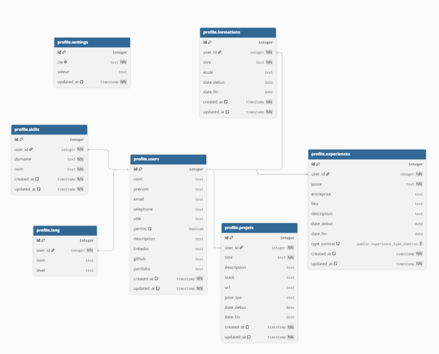
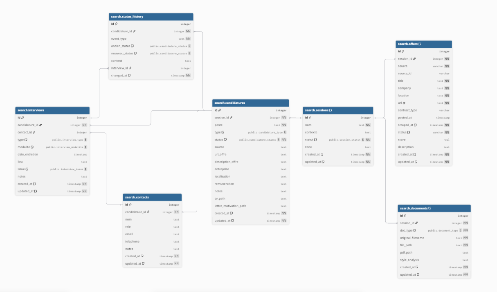

# FindMyJob

Open-source desktop app to track your job applications.

FindMyJob helps students organize their search for an internship, apprenticeship, or full-time job, from the first offer they spot to the final answer. Beyond plain tracking, it uses AI to remove the tedious parts: filling in an offer's details, drafting a follow-up, tailoring a CV and cover letter to the job.

<!-- Screenshot placeholder: add a screenshot of the tracking view here once available. -->

## Features

- **Application tracking** — company, position, contract type (internship / apprenticeship / permanent / fixed-term / temp / freelance), contacts, notes, full status timeline (applied, follow-ups, interviews, offer, outcome).
- **AI-tailored CV and cover letter** — generated from your profile and the offer's text, in your own document's style.
- **AI-drafted application message** — a short email or message adapted to the offer when you apply.
- **Offer import** — paste a job listing's URL or its raw text, and the form is prefilled automatically (title, company, location, contract type, pay, description) for you to review.
- **Interview planning** — week/month views across all your applications.

Every offer enters the app through its link (or its pasted text): FindMyJob never collects offers on its own.

## Architecture

FindMyJob is a Cargo workspace with three crates:

```
crates/core     shared business logic — models, LLM calls, offer page fetch and text extraction (no DB, no Tauri)
crates/agent    headless Axum server — owns PostgreSQL, offer extraction by link, document generation
crates/desktop  Tauri 2 + Vue 3 app — thin HTTP client of the agent, no direct DB access
```

The agent runs locally next to PostgreSQL (Docker Compose), and the desktop app never talks to the database directly: it calls the agent's REST API over HTTP, on `http://localhost:3000` by default. See [`docs/project.md`](docs/project.md) for the full technical reference (data model, pipelines, API routes, conventions).

## Database

The database is a single PostgreSQL instance split into two schemas:

**Profile** — User identity, skills, education, and app settings.



**Search** — Job search sessions, applications, interviews, and documents.



See [`db/schema.dbml`](db/schema.dbml) for the full column-level reference (the diagrams are static images and may lag behind it).

## Prerequisites

- [Node.js](https://nodejs.org/) 18+
- [Rust](https://rustup.rs/) (stable)
- [Docker](https://www.docker.com/) (to run PostgreSQL and the agent)
- Tauri system dependencies: [official guide](https://tauri.app/start/prerequisites/)
- An [Anthropic API key](https://console.anthropic.com/) for the AI features

## Getting started

```bash
git clone https://github.com/KanASon/FindMyJob.git
cd FindMyJob
cp .env.example .env   # fill in ANTHROPIC_API_KEY at minimum
```

Start PostgreSQL and the agent, both on your machine (migrations are applied when the agent starts):

```bash
docker compose up -d
```

Or, to run the agent from source against a Postgres of your own (useful while iterating on the agent):

```bash
cargo run -p findmyjob-agent
```

Then run the desktop app:

```bash
cd crates/desktop
npm install
npm run tauri dev
```

### Production build

```bash
cd crates/desktop
npm run tauri build
```

The installer is generated under `target/release/bundle/` at the repo root.

## Tech stack

| Layer | Technology |
|---|---|
| Desktop shell | Tauri 2 (Windows / macOS / Linux) |
| Frontend | Vue 3 + TypeScript + Vite + Tailwind CSS |
| Backend | Rust, Axum |
| Database | PostgreSQL + pgvector, via sqlx |
| Document generation | Typst (`typst-as-lib`) |
| AI | Anthropic Claude Messages API |

## License

[MIT](LICENSE)

## Project status

Active early-stage development. Application tracking, AI document tailoring, and offer import by link are implemented end to end. Recruiter-contact creation isn't persisted yet — see [`docs/project.md`](docs/project.md#11-features--implemented-partial-and-planned) for the full picture.

## History

An early version collected offers automatically (Welcome to the Jungle, filtering, LLM scoring). I removed it after realizing this approach went against the terms of use of several job platforms. The app now relies on adding offers by their link. The original pipeline is still available at the `archive/collecte-automatique` tag.

## About

I'm a computer engineering student and, like many, struggling to find an internship. Between dozens of applications to track, follow-ups to remember, and forms to fill by hand, I ended up building my own tool to stay on top of it. I decided to open-source it to help people in the same situation.
